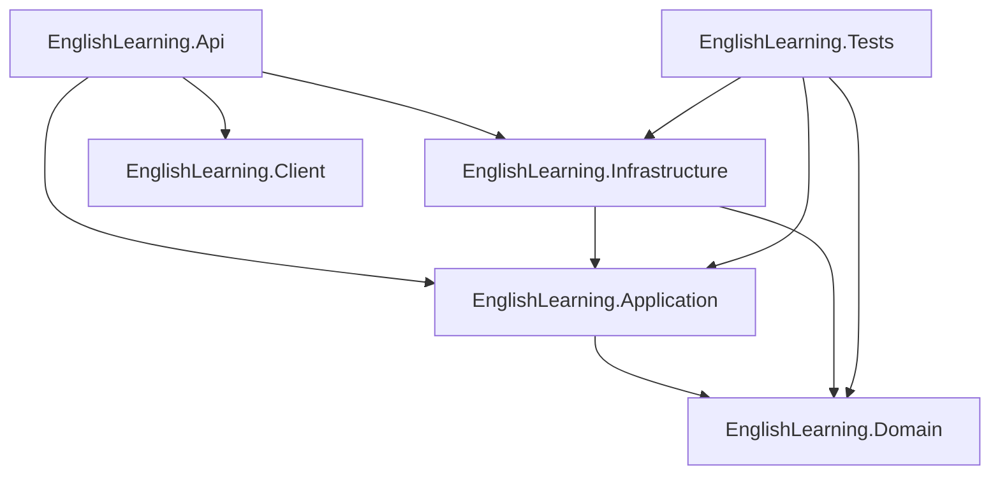
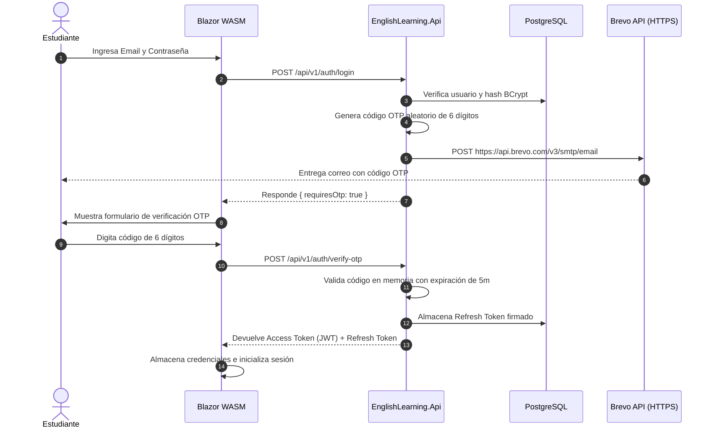

# English Learning Platform

[](https://dotnet.microsoft.com/)
[](https://dotnet.microsoft.com/apps/aspnet/web-apps/blazor)
[](https://www.postgresql.org/)
[](https://aistudio.google.com/)
[](https://www.brevo.com/)
[](https://render.com/)
[](https://xunit.net/)

Plataforma full-stack de aprendizaje de inglés construida con **.NET 9**, **Blazor WebAssembly** y **PostgreSQL**. Permite a los estudiantes aprender inglés de forma progresiva a través de lecciones dinámicas adaptadas a su nivel CEFR, evaluaciones diagnósticas multifactoriales, reportes analíticos de evolución y un **Tutor de Inteligencia Artificial impulsado por Google Gemini** con síntesis de voz en tiempo real.

---

## 🌐 Enlaces del Proyecto en Vivo

* 🚀 **Aplicación Web en Producción**: [https://englishlearning-mum4.onrender.com](https://englishlearning-mum4.onrender.com)
* 📖 **Documentación Interactiva (Swagger OpenAPI)**: [https://englishlearning-mum4.onrender.com/swagger](https://englishlearning-mum4.onrender.com/swagger)
* 🩺 **Health Check del Servidor & Base de Datos**: [https://englishlearning-mum4.onrender.com/health](https://englishlearning-mum4.onrender.com/health)

---

## Índice

- [Características Principales](#características-principales)
- [Documentación Interactiva (Swagger / OpenAPI)](#documentación-interactiva-swagger--openapi)
- [Arquitectura del Sistema](#arquitectura-del-sistema)
- [Estructura del Repositorio](#estructura-del-repositorio)
- [Stack Tecnológico](#stack-tecnológico)
- [Dominio y Modelo de Datos](#dominio-y-modelo-de-datos)
- [API — Catálogo Completo de Endpoints](#api--catálogo-completo-de-endpoints)
- [Flujo de Autenticación y Seguridad OTP](#flujo-de-autenticación-y-seguridad-otp)
- [Sistema de Niveles CEFR y Evaluación](#sistema-de-niveles-cefr-y-evaluación)
- [Tutor de Inteligencia Artificial (Google Gemini)](#tutor-de-inteligencia-artificial-google-gemini)
- [Servicio de Mensajería Transaccional (Brevo API)](#servicio-de-mensajería-transaccional-brevo-api)
- [Ejemplos Prácticos de Consumo (cURL)](#ejemplos-prácticos-de-consumo-curl)
- [Setup Local](#setup-local)
- [Setup con Docker](#setup-con-docker)
- [Configuración y Variables de Entorno](#configuración-y-variables-de-entorno)
- [Migraciones y Seeding de EF Core](#migraciones-y-seeding-de-ef-core)
- [Tests Unitarios y Cobertura](#tests-unitarios-y-cobertura)
- [Despliegue en Render](#despliegue-en-render)
- [Preguntas Frecuentes y Troubleshooting](#preguntas-frecuentes-y-troubleshooting)
- [Autor](#-autor)
- [Licencia](#-licencia)

---

## Características Principales

* 🎯 **Evaluación Diagnóstica (Placement Test)**: Test de posicionamiento inicial que mide integralmente las 4 habilidades esenciales del idioma (*Reading, Listening, Writing, Speaking*) y calcula con precisión el nivel CEFR del estudiante (**A1 → C1**).
* 📚 **Lecciones Dinámicas por Nivel**: Contenido educativo filtrado por el nivel CEFR actual. Cada lección agrupa lecturas, audios y ejercicios estructurados de dificultad progresiva.
* 🧠 **Evaluación Inteligente de Ejercicios**: Motor de evaluación multi-estrategia desacoplado:
  * `CaseInsensitiveExact`: Coincidencia exacta ignorando diferencias de mayúsculas/minúsculas.
  * `Fuzzy`: Coincidencia aproximada mediante similitud de cadenas (*Levenshtein distance*) con umbral configurable (default 85%).
  * `Regex`: Evaluación basada en expresiones regulares para validar patrones y respuestas abiertas.
* 🤖 **Tutor de IA (Google Gemini 3.8 Flash)**: Asistente conversacional especializado en pedagogía de la lengua inglesa. Resuelve dudas gramaticales, corrige oraciones con explicaciones constructivas, practica diálogos y orienta sobre fonética IPA.
* 🗣️ **Text-to-Speech Integrado**: Síntesis de voz nativa del navegador (*Web Speech API*) para escuchar la pronunciación exacta de las respuestas del tutor.
* 📊 **Analítica y Seguimiento de Progreso**: Panel con métricas de desempeño, historial de respuestas por ejercicio, porcentaje de avance por nivel y recomendaciones personalizadas.
* 🔐 **Seguridad y Autenticación en 2 Fases**: Arquitectura robusta con **JWT Bearer**, rotación de **Refresh Tokens** y **códigos OTP de 6 dígitos** enviados por correo electrónico mediante Brevo API HTTPS.
* 🛡️ **Resiliencia y Rate Limiting**: Protección granular por IP con `AspNetCoreRateLimit` para mitigar ataques de fuerza bruta y abusos, sumado a políticas de reintento y fallback con `Polly`.
* 📦 **Contenedor Docker Monolítico Unificado**: La API ASP.NET Core aloja y sirve directamente los archivos estáticos de Blazor WebAssembly (`UseBlazorFrameworkFiles`, `UseStaticFiles`, `MapFallbackToFile("index.html")`), eliminando la necesidad de múltiples servidores o problemas de CORS en producción.

---

## Documentación Interactiva (Swagger / OpenAPI)

La API cuenta con documentación interactiva basada en la especificación **OpenAPI 3.0** generada con **Swashbuckle**. Permite explorar todas las rutas, consultar los esquemas de datos de entrada/salida y probar las solicitudes en vivo directamente desde el navegador.

### 📍 Acceso a Swagger:
* **Entorno de Producción**: [https://englishlearning-mum4.onrender.com/swagger](https://englishlearning-mum4.onrender.com/swagger)
* **Entorno Local**: [https://localhost:7017/swagger](https://localhost:7017/swagger) o [http://localhost:5252/swagger](http://localhost:5252/swagger)

> [!TIP]
> **Habilitación en Producción:**  
> Por motivos de seguridad y rendimiento, Swagger se expone en entornos ajenos a desarrollo configurando la variable de entorno:  
> `EnableSwagger = true` en el panel de Render.

### 🔑 Cómo Autenticarse en Swagger UI:
1. Dirígete al endpoint `POST /api/v1/auth/login` dentro de la UI de Swagger y ejecuta tu solicitud con tus credenciales.
2. Ingresa el código OTP de 6 dígitos recibido en tu correo electrónico en `POST /api/v1/auth/verify-otp`.
3. Copia el token de acceso (`accessToken`) de la respuesta JSON.
4. En la parte superior derecha de la página de Swagger, haz clic en el botón verde **Authorize** 🔓.
5. En el campo de texto, introduce:
   ```text
   Bearer TU_ACCESS_TOKEN_AQUI
   ```
6. Haz clic en **Authorize** y luego en **Close**. A partir de este momento, todos los endpoints protegidos (marcados con un candado cerrado) se ejecutarán con tu identidad de usuario autenticado.

---

## Arquitectura del Sistema

El proyecto está diseñado bajo los principios de **Clean Architecture**, **Domain-Driven Design (DDD)** y el patrón **CQRS** con **MediatR**:

```text
┌─────────────────────────────────────────────────────────────────┐
│                    EnglishLearning.Client                       │
│           Blazor WebAssembly (SPA) — net9.0                     │
│  Pages: Landing · Login · Register · Dashboard · LessonsList    │
│         LessonPlayer · Chat · Profile · Progress · Placement    │
└───────────────────────────┬─────────────────────────────────────┘
                            │ HTTP / JSON
┌───────────────────────────▼─────────────────────────────────────┐
│                    EnglishLearning.Api                          │
│         ASP.NET Core Web API — net9.0                           │
│  Controllers: Auth · Lessons · Assessments · Users · Progress   │
│               Chat                                              │
│  Middleware: ExceptionHandling · CorrelationId · SecurityHeaders│
│              RateLimiting                                       │
│  Logging: Serilog  │  Auth: JWT Bearer  │  Docs: Swagger        │
└───────────────────────────┬─────────────────────────────────────┘
                            │ MediatR (CQRS)
┌───────────────────────────▼─────────────────────────────────────┐
│                 EnglishLearning.Application                     │
│   Features: Auth · Lessons · Assessments · Users                │
│   FluentValidation · Mapster · Abstractions (interfaces)       │
└───────────────────────────┬─────────────────────────────────────┘
                            │ Domain interfaces
┌───────────────────────────▼─────────────────────────────────────┐
│                   EnglishLearning.Domain                        │
│   Entities · Value Objects · Enums · Domain Events              │
│   Domain Services: ExerciseEvaluator · LevelCalculator         │
│                    RecommendationEngine · OtpService            │
└───────────────────────────┬─────────────────────────────────────┘
                            │ implements
┌───────────────────────────▼─────────────────────────────────────┐
│               EnglishLearning.Infrastructure                    │
│   EF Core + Npgsql (PostgreSQL / Supabase)                     │
│   Repositories (CQRS split) · Unit of Work                     │
│   JWT Service · BCrypt · OTP Service                           │
│   Brevo Email API · Google Gemini AI · Polly (resilience)      │
└─────────────────────────────────────────────────────────────────┘
```

### Diagrama de Dependencias entre Proyectos



---

## Estructura del Repositorio

```text
EnglishLearning/
├── EnglishLearning.sln                    # Solución global con 6 proyectos
├── Dockerfile                             # Multi-stage build optimizado para producción
├── docker-compose.yml                     # PostgreSQL 16 + pgAdmin 4 para desarrollo local
├── render.yaml                            # Configuración declarativa de infraestructura en Render
│
├── EnglishLearning.Domain/                # Capa de dominio pura (sin dependencias de infraestructura)
│   ├── Common/                            # AggregateRoot, Entity, Result<T>, Error
│   ├── Entities/                          # Entidades del modelo de negocio
│   │   └── Entidades.cs                   # Usuario, Leccion, Ejercicio, RespuestaUsuario,
│   │                                      # ProgresoNivel, PreguntaDiagnostica, EvaluacionDiagnostica
│   ├── ValueObjects/                      # Objetos de valor inmutables
│   │   └── ValueObjects.cs                # Email, Percentage, UserId, ExerciseId, LevelThreshold
│   ├── Enums/                             # Enumeraciones de dominio
│   │   ├── Enums.cs                       # NivelIngles (A1-C1), TipoEjercicio
│   │   └── Habilidad.cs                   # Reading, Listening, Writing, Speaking
│   ├── Events/                            # Eventos de dominio y abstracciones de despacho
│   │   └── DomainEvents.cs                # LevelChangedEvent, AssessmentCompletedEvent, ExerciseEvaluatedEvent
│   ├── Interfaces/                        # Contratos de repositorios segregados (Command / Query)
│   ├── Options/                           # Opciones de configuración de evaluación y niveles
│   └── Services/                          # Servicios de dominio: Evaluator, Calculator, Engine, Hasher, Otp
│
├── EnglishLearning.Application/           # Capa de aplicación (Casos de uso y orquestación)
│   ├── Abstractions/                      # Interfaces transversales (IJwtTokenService, IEmailService, IChatService)
│   ├── Common/                            # Pipeline Behaviors de MediatR (Logging, Validación)
│   ├── Dtos/                              # DTOs compartidos de transferencia
│   ├── Features/                          # Casos de uso organizados por módulo (Vertical Slices)
│   │   ├── Auth/                          # Comandos, DTOs, Handlers, Templates HTML y Validadores
│   │   ├── Assessments/                   # Preguntas diagnósticas, envío de test y reportes
│   │   ├── Lessons/                       # Listado por nivel, consulta de ejercicios y evaluación
│   │   └── Users/                         # Consulta de perfiles y estados de usuario
│   ├── Mappings/                          # Configuraciones de mapeo con Mapster
│   └── Options/                           # Clases fuertemente tipadas de configuración (Gemini, Brevo, JWT)
│
├── EnglishLearning.Infrastructure/        # Implementación técnica y servicios externos
│   ├── AI/                                # Cliente Google Gemini con Polly y auto-descubrimiento de modelos
│   ├── Events/                            # Implementación en memoria del despachador de eventos de dominio
│   ├── Messaging/                         # Cliente HTTP Brevo REST API para emails transaccionales
│   ├── Migrations/                        # Historial de migraciones de Entity Framework Core
│   ├── Persistence/                       # DbContext, mapeos Fluent API e índices
│   ├── Repositories/                      # Implementaciones concretas de repositorios Command y Query
│   ├── Seed/Data/                         # Archivos JSON con preguntas diagnósticas y lecciones de ejemplo
│   ├── Services/                          # Implementaciones de JWT, OTP en memoria, BCrypt y Seeding
│   └── UnitOfWork/                        # Abstracción transaccional sobre EF Core
│
├── EnglishLearning.Api/                   # Host principal (Web API + Static Host para Blazor WASM)
│   ├── Controllers/v1/                    # Controladores REST: Auth, Lessons, Assessments, Users, Progress, Chat
│   ├── Extensions/                        # Métodos de extensión para DI, Swagger, CORS y HealthChecks
│   ├── Filters/                           # Filtros globales de validación y envoltura de respuesta estándar
│   ├── Middleware/                        # Manejo de excepciones, CorrelationId, RateLimit y SecurityHeaders
│   ├── Program.cs                         # Configuración del pipeline HTTP, auto-migración y bootstrap
│   └── appsettings.json                   # Configuración del sistema
│
├── EnglishLearning.Client/                # Aplicación Frontend Blazor WebAssembly (SPA)
│   ├── Pages/                             # Vistas de la aplicación: Landing, Login, Register, Dashboard, etc.
│   ├── Components/                        # Componentes UI reutilizables y Route Guards de autenticación
│   ├── Services/                          # Servicios de cliente: ApiClient, AuthStateProvider, Toast, Sesión
│   └── Layout/                            # Estructura visual de navegación y componentes compartidos
│
└── EnglishLearning.Tests/                 # Suite de pruebas automatizadas (xUnit + Moq + Coverlet)
    ├── Auth/                              # Pruebas unitarias de autenticación y verificación OTP
    ├── Events/                            # Pruebas de emisión y captura de Domain Events
    ├── Services/                          # Pruebas de lógica de cálculo de nivel y evaluación
    └── Fakes/                             # Repositorios y servicios simulados en memoria
```

---

## Stack Tecnológico

### Backend
| Tecnología | Versión | Propósito |
| :--- | :--- | :--- |
| **.NET / ASP.NET Core** | 9.0 | Runtime y framework base del servidor |
| **Entity Framework Core** | 9.0.0 | ORM de acceso a base de datos relacional |
| **Npgsql.EFCore.PostgreSQL** | 9.0.0 | Driver y proveedor para PostgreSQL |
| **MediatR** | 12.4.1 | Desacoplamiento de casos de uso mediante CQRS |
| **FluentValidation** | 11.9.2 | Validación declarativa de comandos y contratos |
| **Mapster** | 7.4.0 | Mapeo rápido de alto rendimiento de objetos |
| **BCrypt.Net-Next** | 4.0.3 | Algoritmo de derivación y hash de contraseñas |
| **System.IdentityModel.Tokens.Jwt** | 8.0.0 | Creación, firma y validación de tokens JWT |
| **Serilog** | 8.0.0 | Registro de logs estructurado con trazabilidad |
| **AspNetCoreRateLimit** | 5.0.0 | Control de cuota y mitigación de abuso por IP |
| **Polly** | 8.8.0 | Políticas de resiliencia, reintentos exponenciales y fallback |
| **Swashbuckle.AspNetCore** | 6.5.0 | Generación de especificación OpenAPI y Swagger UI |
| **AspNetCore.HealthChecks.NpgSql**| 9.0.0 | Monitoreo activo de conectividad con la base de datos |

### Frontend
| Tecnología | Versión | Propósito |
| :--- | :--- | :--- |
| **Blazor WebAssembly** | 9.0.0 | Framework SPA interactivo en C# cliente ejecutado en WebAssembly |
| **Microsoft.AspNetCore.Components.Authorization** | 9.0.0 | Gestión del estado de autenticación y directivas de seguridad en vistas |
| **System.IdentityModel.Tokens.Jwt** | 8.1.2 | Decodificación y lectura de claims JWT en el navegador |
| **Web Speech API** | Nativa | Síntesis de voz (*SpeechSynthesis*) para pronunciación del tutor |

### Servicios de Infraestructura en la Nube
| Servicio | Rol en el Sistema |
| :--- | :--- |
| **PostgreSQL 16 / Supabase** | Base de datos relacional persistente con SSL y pooler transaccional |
| **Google Gemini AI Studio** | Modelo fundacional para el tutor de inglés (`gemini-3.8-flash`) |
| **Brevo API (v3)** | Pasarela de correo transaccional vía HTTPS (puerto 443) para OTP |
| **Render.com** | Plataforma de alojamiento cloud con despliegue de contenedores Docker |

---

## Dominio y Modelo de Datos

### Entidades Principales

#### 👤 Usuario (`AggregateRoot`)
Representa a un estudiante registrado en la plataforma.
* `Id` (`int`): Identificador único secuencial.
* `Nombre` (`string`): Nombre completo del estudiante.
* `Correo` (`string`): Correo normalizado único.
* `PasswordHash` (`string`): Hash criptográfico seguro generado con BCrypt.
* `NivelActual` (`NivelIngles`): Nivel CEFR asignado (`SinAsignar`, `A1`, `A2`, `B1`, `B2`, `C1`).
* `RefreshToken` (`string?`): Token de renovación criptográfico.
* `RefreshTokenExpiry` (`DateTime?`): Fecha límite de vigencia del Refresh Token.
* `Progresos` (`IReadOnlyList<ProgresoNivel>`): Colección de progresos por nivel completado.
* **Domain Events Emitidos**: `LevelChangedEvent`.

#### 📖 Leccion (`AggregateRoot`)
Unidad pedagógica que contiene un conjunto de ejercicios prácticos.
* `Id` (`int`): Identificador único.
* `Titulo` (`string`): Título representativo de la lección.
* `Descripcion` (`string`): Objetivos pedagógicos de la lección.
* `NivelRequerido` (`NivelIngles`): Nivel CEFR mínimo requerido para desbloquearla.
* `Ejercicios` (`IReadOnlyList<Ejercicio>`): Lista de ejercicios pertenecientes a la lección.

#### ✍️ Ejercicio (`Entity`)
* `Id` (`int`): Identificador único.
* `LeccionId` (`int`): Clave foránea a la lección padre.
* `Contenido` (`string`): Enunciado o consigna a resolver.
* `RespuestaCorrecta` (`string`): Solución esperada.
* `Tipo` (`TipoEjercicio`): `Lectura`, `Escucha`, `Escritura`, `OpcionMultiple`.

#### 📝 EvaluacionDiagnostica (`Entity`)
Almacena el resultado histórico del test de posicionamiento inicial: nivel asignado, puntaje global alcanzado y desglose porcentual por habilidad en formato JSON.

---

## API — Catálogo Completo de Endpoints

Todos los endpoints están prefijados bajo `/api/v1/`. Los endpoints señalados con 🔒 requieren la cabecera `Authorization: Bearer <accessToken>`.

```mermaid
graph LR
    Client([Cliente / Swagger]) -->|HTTP Request| API[EnglishLearning.Api]
    API --> Auth[/api/v1/auth]
    API --> Lessons[/api/v1/lessons]
    API --> Assess[/api/v1/assessments]
    API --> Users[/api/v1/users]
    API --> Progress[/api/v1/progress]
    API --> Chat[/api/v1/chat]
    API --> Health[/health]
    API --> SwaggerDoc[/swagger]
```

### 1. Autenticación — `/api/v1/auth`
| Método | Ruta | Auth | Descripción |
| :--- | :--- | :---: | :--- |
| `POST` | `/api/v1/auth/register` | ❌ | Registra un usuario y envía el código OTP de verificación por correo. |
| `POST` | `/api/v1/auth/login` | ❌ | Valida credenciales, genera OTP y solicita verificación de 6 dígitos. |
| `POST` | `/api/v1/auth/verify-otp` | ❌ | Valida el código OTP y entrega los tokens JWT (`accessToken` + `refreshToken`). |
| `POST` | `/api/v1/auth/resend-otp` | ❌ | Genera y reenvía un nuevo código OTP al correo del usuario. |
| `POST` | `/api/v1/auth/refresh` | ❌ | Rota y renueva el Access Token expirado usando un Refresh Token válido. |
| `POST` | `/api/v1/auth/revoke` | ❌ | Invalida el Refresh Token actual, cerrando la sesión de manera segura. |
| `GET` | `/api/v1/auth/me` | 🔒 | Obtiene la información básica del usuario en sesión. |

### 2. Lecciones y Ejercicios — `/api/v1/lessons`
| Método | Ruta | Auth | Descripción |
| :--- | :--- | :---: | :--- |
| `GET` | `/api/v1/lessons/by-level/{nivel}` | 🔒 | Obtiene las lecciones disponibles para un nivel CEFR (ej. `A1`, `B1`). |
| `GET` | `/api/v1/lessons/{id}` | 🔒 | Obtiene el detalle de una lección específica incluyendo sus ejercicios. |
| `GET` | `/api/v1/lessons/exercises/{id}` | 🔒 | Obtiene los datos de un ejercicio individual por su ID. |
| `POST` | `/api/v1/lessons/evaluate` | 🔒 | Envía y evalúa la respuesta dada por el estudiante a un ejercicio. |

### 3. Evaluación Diagnóstica — `/api/v1/assessments`
| Método | Ruta | Auth | Descripción |
| :--- | :--- | :---: | :--- |
| `GET` | `/api/v1/assessments/questions` | 🔒 | Descarga las preguntas del test diagnóstico inicial (4 habilidades). |
| `POST` | `/api/v1/assessments/submit` | 🔒 | Envía las respuestas del test, calcula y actualiza el nivel del usuario. |
| `GET` | `/api/v1/assessments/progress` | 🔒 | Consulta el reporte de evolución diagnóstica del estudiante. |

### 4. Tutor de Inteligencia Artificial — `/api/v1/chat`
| Método | Ruta | Auth | Descripción |
| :--- | :--- | :---: | :--- |
| `POST` | `/api/v1/chat/ask` | 🔒 | Envía una consulta al tutor IA adaptada al nivel del estudiante y recibe respuesta pedagógica. |

### 5. Usuarios y Progreso — `/api/v1/users` y `/api/v1/progress`
| Método | Ruta | Auth | Descripción |
| :--- | :--- | :---: | :--- |
| `GET` | `/api/v1/users/me` | 🔒 | Datos generales del estudiante autenticado. |
| `GET` | `/api/v1/users/profile` | 🔒 | Perfil completo con estadísticas agregadas de respuestas y nivel. |
| `GET` | `/api/v1/progress` | 🔒 | Resumen cuantitativo del progreso global y lecciones aprobadas. |

### 6. Diagnóstico y Documentación
| Método | Ruta | Auth | Descripción |
| :--- | :--- | :---: | :--- |
| `GET` | `/health` | ❌ | Comprobación de estado del servicio y conectividad activa a PostgreSQL. |
| `GET` | `/swagger` | ❌ | Interfaz gráfica interactiva de documentación OpenAPI. |

---

## Flujo de Autenticación y Seguridad OTP

El sistema implementa autenticación reforzada en dos fases con verificación de canal externo vía OTP por correo electrónico:



---

## Sistema de Niveles CEFR y Evaluación

El cálculo de nivel se fundamenta en el **Marco Común Europeo de Referencia para las Lenguas (CEFR)**.

### Umbrales del Test Diagnóstico
| Nivel | Rango de Aciertos | Competencia Lingüística |
| :---: | :---: | :--- |
| **A1** | `0% - 25%` | Acceso / Principiante: Comprensión de expresiones cotidianas muy básicas. |
| **A2** | `26% - 45%` | Plataforma / Elemental: Comunicación en tareas sencillas y habituales. |
| **B1** | `46% - 65%` | Umbral / Intermedio: Comprensión de puntos principales en contextos conocidos. |
| **B2** | `66% - 85%` | Avanzado / Intermedio Alto: Fluidez con nativos y comprensión de textos complejos. |
| **C1** | `86% - 100%` | Dominio Operativo Eficaz: Uso flexible y estructurado del idioma en cualquier ámbito. |

---

## Tutor de Inteligencia Artificial (Google Gemini)

El servicio `GeminiChatService` actúa como un tutor pedagógico personalizado:
* **Modelo Primario**: `gemini-3.8-flash` (alta velocidad y razonamiento avanzado).
* **Modelo Fallback (Respaldo)**: `gemini-3.5-flash-lite` con cuota de **500 peticiones diarias gratuitas**. Si se alcanza el límite del modelo primario (HTTP 429), el pipeline de resiliencia con **Polly** conmuta automáticamente sin interrumpir al usuario.
* **Auto-Descubrimiento Dinámico**: En caso de un código `404 Not Found` por obsolescencia de versiones en la API de Google, el servicio consulta la lista de modelos de la cuenta y selecciona de forma autónoma el mejor modelo disponible.
* **Instrucción de Sistema Pedagógica**: Configurado para motivar, corregir con explicaciones claras, sugerir estructuras naturales y mantenerse enfocado en el aprendizaje del idioma.

---

## Servicio de Mensajería Transaccional (Brevo API)

Para resolver el bloqueo común de puertos SMTP (`25`, `465`, `587`) que aplican los proveedores de hosting en la nube como Render (Free Tier), el servicio de correo fue migrado a la **API REST de Brevo** mediante solicitudes HTTPS sobre el **puerto 443**:
* **Endpoint utilizado**: `POST https://api.brevo.com/v3/smtp/email`
* **Autenticación**: Cabecera `api-key: xkeysib-...`
* **Seguridad de IPs en Brevo**: Para permitir llamadas desde servidores cloud con IPs dinámicas como Render, se debe mantener desactivado el bloqueo estricto de IPs en:  
  👉 [https://app.brevo.com/security/authorised_ips](https://app.brevo.com/security/authorised_ips) (*Desactivar para claves API*).

---

## Ejemplos Prácticos de Consumo (cURL)

### 1. Comprobar Salud del Servidor
```bash
curl -X GET "https://englishlearning-mum4.onrender.com/health"
```

### 2. Iniciar Sesión (Solicitar OTP)
```bash
curl -X POST "https://englishlearning-mum4.onrender.com/api/v1/auth/login" \
  -H "Content-Type: application/json" \
  -d '{
    "email": "estudiante@ejemplo.com",
    "password": "Password123!"
  }'
```

### 3. Verificar Código OTP
```bash
curl -X POST "https://englishlearning-mum4.onrender.com/api/v1/auth/verify-otp" \
  -H "Content-Type: application/json" \
  -d '{
    "email": "estudiante@ejemplo.com",
    "otp": "123456"
  }'
```

### 4. Consultar al Tutor de IA
```bash
curl -X POST "https://englishlearning-mum4.onrender.com/api/v1/chat/ask" \
  -H "Content-Type: application/json" \
  -H "Authorization: Bearer TU_TOKEN_JWT" \
  -d '{
    "message": "Can you explain the difference between make and do with examples?"
  }'
```

---

## Setup Local

### Prerrequisitos
* [.NET 9 SDK](https://dotnet.microsoft.com/download/dotnet/9)
* [PostgreSQL 16+](https://www.postgresql.org/download/) o Docker Desktop
* API Key de [Google AI Studio](https://aistudio.google.com/apikey)
* API Key de [Brevo](https://www.brevo.com/)

### 1. Clonar el Repositorio
```bash
git clone https://github.com/Leonme21/EnglishLearning.git
cd EnglishLearning
```

### 2. Configurar Secretos Locales
Edita `EnglishLearning.Api/appsettings.Development.json`:
```json
{
  "ConnectionStrings": {
    "DefaultConnection": "Host=localhost;Database=englishlearning;Username=postgres;Password=TU_PASSWORD;Port=5432"
  },
  "Jwt": {
    "SecretKey": "SuperClaveSecretaParaDesarrolloLocalDeAlMenos32Caracteres!#"
  },
  "Gemini": {
    "ApiKey": "TU_GOOGLE_AI_STUDIO_API_KEY",
    "Model": "gemini-3.8-flash",
    "FallbackModel": "gemini-3.5-flash-lite"
  },
  "Brevo": {
    "ApiKey": "TU_BREVO_API_KEY_xkeysib-...",
    "FromEmail": "tu_correo_verificado@gmail.com",
    "FromName": "English Learning Platform"
  }
}
```

### 3. Ejecutar la Aplicación
```bash
dotnet run --project EnglishLearning.Api
```
La aplicación aplicará automáticamente las migraciones pendientes y cargará las lecciones iniciales. Estará disponible en:
* **Aplicación Web**: [https://localhost:7017](https://localhost:7017) o [http://localhost:5252](http://localhost:5252)
* **Swagger UI**: [https://localhost:7017/swagger](https://localhost:7017/swagger)

---

## Setup con Docker

### Base de Datos para Desarrollo Local
```bash
docker compose up -d
```
* **PostgreSQL 16**: `localhost:5432` (`postgres` / `postgres`)
* **pgAdmin 4**: [http://localhost:5050](http://localhost:5050) (`admin@englishlearning.com` / `admin`)

### Compilación y Ejecución del Contenedor de Producción
```bash
# Compilar imagen unificada (API + Blazor WASM)
docker build -t englishlearning-app .

# Ejecutar contenedor
docker run -p 8080:8080 \
  -e ConnectionStrings__DefaultConnection="Host=...;Database=...;Username=...;Password=..." \
  -e Jwt__SecretKey="SuperClaveSecretaParaProduccion123456789!#" \
  -e Gemini__ApiKey="AIzaSy..." \
  -e Brevo__ApiKey="xkeysib-..." \
  -e Brevo__FromEmail="tu_correo@gmail.com" \
  -e EnableSwagger="true" \
  englishlearning-app
```

---

## Configuración y Variables de Entorno

En entornos de producción (como Render o Kubernetes), la configuración se mapea mediante variables de entorno usando el estándar de doble guión bajo (`__`):

| Variable de Entorno | Sección en `appsettings.json` | Obligatoria | Descripción |
| :--- | :--- | :---: | :--- |
| `ConnectionStrings__DefaultConnection` | `ConnectionStrings.DefaultConnection` | **Sí** | Cadena de conexión PostgreSQL (ej. Supabase modo sesión, puerto 5432). |
| `Jwt__SecretKey` | `Jwt.SecretKey` | **Sí** | Clave criptográfica HMAC para firmar tokens JWT (mínimo 32 caracteres). |
| `Jwt__Issuer` | `Jwt.Issuer` | No | Emisor del token (default: `EnglishLearning.Api`). |
| `Jwt__Audience` | `Jwt.Audience` | No | Audiencia esperada del token (default: `EnglishLearning.Client`). |
| `Gemini__ApiKey` | `Gemini.ApiKey` | **Sí** | Clave API de Google AI Studio (empieza con `AIzaSy...`). |
| `Gemini__Model` | `Gemini.Model` | No | Modelo primario de Gemini (default: `gemini-3.8-flash`). |
| `Gemini__FallbackModel` | `Gemini.FallbackModel` | No | Modelo de respaldo si se agota la cuota (default: `gemini-3.5-flash-lite`). |
| `Brevo__ApiKey` | `Brevo.ApiKey` | **Sí** | Clave API de Brevo para envío de emails (empieza con `xkeysib-...`). |
| `Brevo__FromEmail` | `Brevo.FromEmail` | **Sí** | Correo electrónico verificado como remitente en la cuenta de Brevo. |
| `Brevo__FromName` | `Brevo.FromName` | No | Nombre que aparecerá en el remitente de los correos recibidos. |
| `EnableSwagger` | — | No | Si es `true`, expone la UI de Swagger en producción en `/swagger`. |
| `ASPNETCORE_HTTP_PORTS` | — | No | Puerto de escucha HTTP en Linux Docker (default en Render: `8080`). |
| `ASPNETCORE_ENVIRONMENT` | — | No | Entorno de ejecución (`Production` o `Development`). |

---

## Migraciones y Seeding de EF Core

El proyecto gestiona la persistencia mediante migraciones de **Entity Framework Core**:
* **Migraciones automáticas al inicio**: `Program.cs` ejecuta `dbContext.Database.MigrateAsync()` en el arranque del contenedor.
* **Seeding idempotente**: `SeedDataService` carga datos iniciales de lecciones, ejercicios y preguntas diagnósticas desde archivos JSON ubicados en `Seed/Data/`.

### Comandos de Mantenimiento Manual
```bash
# Agregar una nueva migración
dotnet ef migrations add NombreDeMigracion \
  --project EnglishLearning.Infrastructure \
  --startup-project EnglishLearning.Api

# Aplicar migraciones a la base de datos
dotnet ef database update \
  --project EnglishLearning.Infrastructure \
  --startup-project EnglishLearning.Api

# Generar script SQL puro para auditoría
dotnet ef migrations script \
  --project EnglishLearning.Infrastructure \
  --startup-project EnglishLearning.Api \
  --output migration.sql
```

---

## Tests Unitarios y Cobertura

La suite de pruebas automatizadas está construida con **xUnit** y mide la cobertura del núcleo del dominio y la aplicación:

```bash
# Ejecutar todas las pruebas unitarias
dotnet test
```

### Métricas de Validación
* **Pruebas Totales**: 32 pruebas unitarias.
* **Estado**: ✅ **32 / 32 Superadas (100% Passing)**.
* **Áreas Cubiertas**:
  * Autenticación, generación y validación de OTP en memoria (`OtpAuthTests.cs`).
  * Registro de usuarios, hash BCrypt y asignación inicial (`RegisterHandlerTests.cs`).
  * Emisión y captura de eventos de dominio (`DomainEventDispatcherTests.cs`).
  * Evaluación de respuestas con algoritmos exactos, difusos y expresiones regulares.
  * Lógica matemática de cálculo y promoción de niveles CEFR.

---

## Despliegue en Render

El archivo `render.yaml` declara la infraestructura del Web Service:

```yaml
services:
  - type: web
    name: englishlearning-api
    env: docker
    region: oregon
    plan: free
    healthCheckPath: /health
    envVars:
      - key: ASPNETCORE_ENVIRONMENT
        value: Production
      - key: ASPNETCORE_HTTP_PORTS
        value: 8080
      - key: ConnectionStrings__DefaultConnection
        sync: false
      - key: Jwt__SecretKey
        generateValue: true
      - key: Gemini__ApiKey
        sync: false
      - key: Brevo__ApiKey
        sync: false
      - key: Brevo__FromEmail
        sync: false
      - key: Brevo__FromName
        value: English Learning Platform
      - key: EnableSwagger
        value: "true"
```

---

## Preguntas Frecuentes y Troubleshooting

### ❓ ¿Por qué no recibo el correo con el código OTP?
1. **Bloqueo de IPs en Brevo**: Brevo bloquea solicitudes de IPs de centros de datos desconocidos por defecto. Ingresa a [https://app.brevo.com/security/authorised_ips](https://app.brevo.com/security/authorised_ips) y haz clic en **"Desactivar para claves API"**.
2. **Remitente verificado**: La variable `Brevo__FromEmail` debe coincidir exactamente con el correo con el que registraste tu cuenta en Brevo (ej. tu cuenta de Gmail).
3. **Carpeta de Spam**: Los correos transaccionales iniciales pueden llegar a la carpeta de correo no deseado/spam.

### ❓ ¿Por qué el Tutor de IA devuelve un error de mensaje?
1. **API Key de Gemini**: Confirma que la variable `Gemini__ApiKey` en Render comience con `AIzaSy...` y que no contenga comillas ni espacios extra.
2. **Cuota del modelo**: Si la cuota gratuita diaria de `gemini-3.8-flash` se satura, el sistema pasará automáticamente a `gemini-3.5-flash-lite`. Verifica el uso en la consola de [Google AI Studio](https://aistudio.google.com/).

### ❓ ¿Por qué la aplicación tarda cerca de 40 segundos en abrir por primera vez?
En el plan **Free** de Render, los contenedores entran en reposo tras 15 minutos sin recibir tráfico para ahorrar recursos. El primer acceso desencadena un arranque en frío (*cold start*) que tarda entre 30 y 50 segundos. Una vez activo, responderá al instante.

---

## 👨‍💻 Autor

Desarrollado por **Miguel León y Doncan Casquete**  
* GitHub: [@Leonme21](https://github.com/Leonme21)
* Repositorio del Proyecto: [Leonme21/EnglishLearning](https://github.com/Leonme21/EnglishLearning)

---

