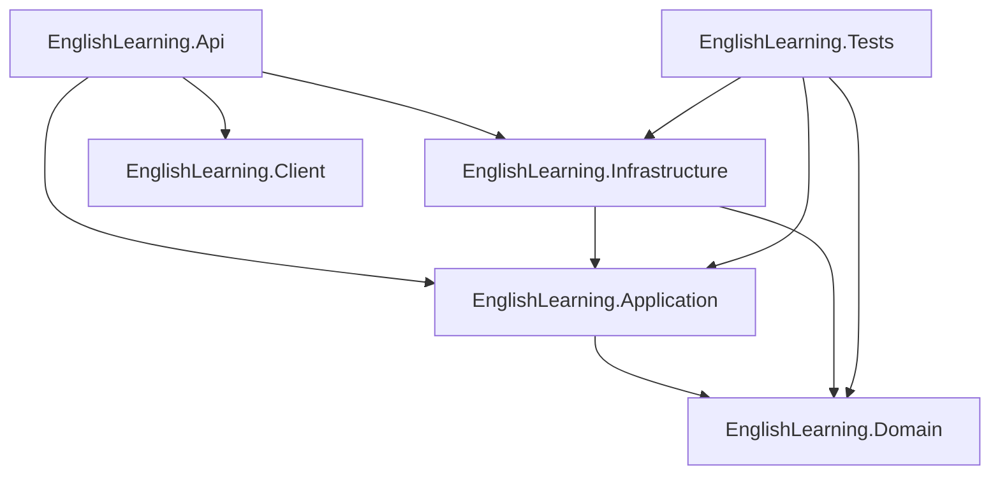

# English Learning Platform

Plataforma full-stack de aprendizaje de inglés construida con **.NET 9**, **Blazor WebAssembly** y **PostgreSQL**. Permite a los usuarios aprender inglés de forma progresiva a través de lecciones adaptadas a su nivel CEFR, evaluaciones diagnósticas, seguimiento de progreso y un tutor de inteligencia artificial impulsado por Google Gemini.

---

## Índice

- [Características](#características)
- [Arquitectura](#arquitectura)
- [Estructura del repositorio](#estructura-del-repositorio)
- [Stack tecnológico](#stack-tecnológico)
- [Dominio y modelo de datos](#dominio-y-modelo-de-datos)
- [API — Endpoints](#api--endpoints)
- [Flujo de autenticación](#flujo-de-autenticación)
- [Sistema de niveles CEFR](#sistema-de-niveles-cefr)
- [Servicios externos](#servicios-externos)
- [Setup local](#setup-local)
- [Setup con Docker](#setup-con-docker)
- [Configuración — variables de entorno](#configuración--variables-de-entorno)
- [Migraciones EF Core](#migraciones-ef-core)
- [Tests](#tests)
- [Deploy en Render](#deploy-en-render)

---

## Características

- **Evaluación diagnóstica**: test de posicionamiento inicial que mide las 4 habilidades (Reading, Listening, Writing, Speaking) y asigna automáticamente el nivel CEFR del usuario (A1 → C1).
- **Lecciones por nivel**: contenido filtrado dinámicamente por el nivel CEFR del usuario. Cada lección agrupa ejercicios de distintos tipos.
- **Ejercicios con evaluación inteligente**: soporte para tres estrategias de evaluación configurables — coincidencia exacta (case-insensitive), fuzzy matching con umbral configurable y evaluación por expresiones regulares.
- **Tutor de IA (Gemini)**: chat interactivo con Google Gemini AI para resolver dudas gramaticales, corregir frases, practicar conversación y explicar pronunciación. Incluye síntesis de voz (Web Speech API) para escuchar las respuestas del tutor.
- **Seguimiento de progreso**: historial de respuestas, porcentaje completado por nivel y reporte de evolución.
- **Autenticación completa**: registro/login con JWT Bearer + Refresh Token + OTP por email para verificación de cuenta.
- **Rate limiting**: protección contra abuso en todos los endpoints con reglas granulares por IP.
- **Health check**: endpoint `/health` con comprobación activa de la base de datos PostgreSQL.
- **Seed automático**: datos iniciales de lecciones, ejercicios y preguntas diagnósticas cargados automáticamente al iniciar.
- **Frontend Blazor WASM**: SPA servida desde el mismo proceso ASP.NET Core, sin servidor separado.

---

## Arquitectura

El proyecto sigue **Clean Architecture** con separación estricta de capas. La capa de aplicación implementa el patrón **CQRS** con MediatR y aplica principios de **DDD** (Aggregates, Value Objects, Domain Events).

```
┌─────────────────────────────────────────────────────────────────┐
│                    EnglishLearning.Client                        │
│           Blazor WebAssembly (SPA)  — net9.0                    │
│  Pages: Landing · Login · Register · Dashboard · LessonsList    │
│         LessonPlayer · Chat · Profile · Progress · Placement    │
└───────────────────────────┬─────────────────────────────────────┘
                            │ HTTP / JSON
┌───────────────────────────▼─────────────────────────────────────┐
│                    EnglishLearning.Api                           │
│         ASP.NET Core Web API  — net9.0                          │
│  Controllers: Auth · Lessons · Assessments · Users · Progress   │
│               Chat                                              │
│  Middleware: ExceptionHandling · CorrelationId · SecurityHeaders │
│              RateLimiting                                       │
│  Logging: Serilog  │  Auth: JWT Bearer  │  Docs: Swagger        │
└───────────────────────────┬─────────────────────────────────────┘
                            │ MediatR (CQRS)
┌───────────────────────────▼─────────────────────────────────────┐
│                 EnglishLearning.Application                      │
│   Features: Auth · Lessons · Assessments · Users               │
│   FluentValidation · Mapster · Abstractions (interfaces)        │
└───────────────────────────┬─────────────────────────────────────┘
                            │ Domain interfaces
┌───────────────────────────▼─────────────────────────────────────┐
│                   EnglishLearning.Domain                         │
│   Entities · Value Objects · Enums · Domain Events              │
│   Domain Services: ExerciseEvaluator · LevelCalculator          │
│                    RecommendationEngine · OtpService            │
└───────────────────────────┬─────────────────────────────────────┘
                            │ implements
┌───────────────────────────▼─────────────────────────────────────┐
│               EnglishLearning.Infrastructure                     │
│   EF Core + Npgsql (PostgreSQL / Supabase)                      │
│   Repositories (CQRS split) · Unit of Work                      │
│   JWT Service · BCrypt · OTP Service                            │
│   Brevo Email API · Google Gemini AI · Polly (resilience)       │
└─────────────────────────────────────────────────────────────────┘
```

### Diagrama de dependencias entre proyectos



---

## Estructura del repositorio

```
EnglishLearning/
├── EnglishLearning.sln                    # Solución con 6 proyectos
├── Dockerfile                             # Build multi-stage para producción
├── docker-compose.yml                     # PostgreSQL 16 + pgAdmin 4 para desarrollo local
├── render.yaml                            # Configuración de deploy en Render.com
│
├── EnglishLearning.Domain/                # Capa de dominio (sin dependencias externas)
│   ├── Common/                            # AggregateRoot, Entity, Result<T>, Error
│   ├── Entities/                          # Entidades del dominio
│   │   └── Entidades.cs                   # Usuario, Leccion, Ejercicio, RespuestaUsuario,
│   │                                      # ProgresoNivel, PreguntaDiagnostica, EvaluacionDiagnostica
│   ├── ValueObjects/
│   │   └── ValueObjects.cs                # Email, Percentage, UserId, ExerciseId, LevelThreshold
│   ├── Enums/
│   │   ├── Enums.cs                       # NivelIngles, TipoEjercicio
│   │   └── Habilidad.cs                   # Reading, Listening, Writing, Speaking
│   ├── Events/
│   │   └── DomainEvents.cs                # LevelChangedEvent, AssessmentCompletedEvent,
│   │                                      # ExerciseEvaluatedEvent + dispatcher + handler interfaces
│   ├── Interfaces/                        # ILeccionQueryRepository, ILeccionCommandRepository,
│   │                                      # IUsuarioQueryRepository, IUsuarioCommandRepository,
│   │                                      # IAssessmentQueryRepository, IAssessmentCommandRepository,
│   │                                      # IRefreshTokenQueryRepository, IRefreshTokenCommandRepository
│   ├── Options/                           # LevelCalculationOptions, AssessmentOptions,
│   │                                      # ExerciseEvaluationOptions
│   └── Services/                          # IExerciseEvaluator, ILevelCalculator, IRecommendationEngine,
│                                          # IPasswordHasher, IOtpService + implementaciones de dominio
│
├── EnglishLearning.Application/           # Capa de aplicación (casos de uso)
│   ├── Abstractions/                      # IJwtTokenService, IEmailService, IChatService
│   ├── Common/                            # Behaviours de MediatR (validación, logging)
│   ├── Dtos/                              # DTOs compartidos
│   ├── Features/
│   │   ├── Auth/
│   │   │   ├── Commands/                  # LoginCommand, RegisterCommand, RefreshTokenCommand,
│   │   │   │                              # RevokeTokenCommand, VerifyOtpCommand, ResendOtpCommand
│   │   │   ├── DTOs/                      # AuthResponse, LoginRequest, RegisterRequest,
│   │   │   │                              # VerifyOtpRequest, ResendOtpRequest, RefreshTokenRequest
│   │   │   ├── Handlers/                  # Un handler por comando
│   │   │   ├── Templates/                 # Plantillas HTML para emails OTP
│   │   │   └── Validators/                # FluentValidation validators
│   │   ├── Assessments/
│   │   │   ├── Commands/                  # SubmitAssessmentCommand + Handler
│   │   │   ├── DTOs/                      # SubmitAssessmentRequest/Response, ProgressReport
│   │   │   ├── Queries/                   # GetAssessmentQuestionsQuery, GetProgressReportQuery
│   │   │   └── Validators/
│   │   ├── Lessons/
│   │   │   ├── Commands/                  # EvaluateExerciseCommand + Handler
│   │   │   ├── DTOs/                      # LessonDto, ExerciseDto, EvaluateExerciseRequest
│   │   │   ├── Queries/                   # GetLessonsByLevelQuery, GetLessonByIdQuery,
│   │   │   │                              # GetExerciseByIdQuery
│   │   │   └── Validators/
│   │   └── Users/
│   │       ├── DTOs/                      # UserDto, UserProfileDto
│   │       └── Queries/                   # GetUserByIdQuery, GetUserProfileQuery
│   ├── Mappings/                          # Perfiles Mapster
│   ├── Options/                           # GeminiSettings, SmtpSettings, BrevoSettings
│   └── Services/                          # Servicios de aplicación transversales
│
├── EnglishLearning.Infrastructure/        # Capa de infraestructura (acceso a datos y externos)
│   ├── AI/
│   │   └── GeminiChatService.cs           # Cliente HTTP para Google Gemini API
│   ├── Events/
│   │   └── DomainEventDispatcher.cs       # Despacho de domain events
│   ├── Messaging/
│   │   └── BrevoEmailService.cs           # Cliente HTTP para Brevo Email API
│   ├── Migrations/
│   │   ├── 20261004224805_InitialCreate   # Esquema inicial: usuarios, lecciones, ejercicios, respuestas, progreso
│   │   └── 20261004233343_AddAuthTables   # Tablas de auth: refresh tokens, evaluaciones, preguntas diagnósticas
│   ├── Persistence/
│   │   └── EnglishLearningDbContext.cs    # DbContext EF Core con todas las configuraciones de entidades
│   ├── Repositories/
│   │   ├── Assessments/                   # AssessmentQueryRepository, AssessmentCommandRepository
│   │   ├── Auth/                          # RefreshTokenQueryRepository, RefreshTokenCommandRepository
│   │   ├── Lessons/                       # LeccionQueryRepository, LeccionCommandRepository
│   │   └── Users/                         # UsuarioQueryRepository, UsuarioCommandRepository
│   ├── Seed/
│   │   └── Data/                          # Archivos JSON de seed (lecciones, ejercicios, preguntas)
│   ├── Services/
│   │   ├── JwtTokenService.cs             # Generación/validación de JWT + Refresh Token
│   │   ├── OtpService.cs                  # Generación y verificación de códigos OTP
│   │   ├── PasswordHasher.cs              # BCrypt wrapper
│   │   └── SeedDataService.cs             # Servicio de carga de datos iniciales
│   ├── UnitOfWork/
│   │   └── UnitOfWork.cs                  # Patrón Unit of Work sobre DbContext
│   └── ServiceCollectionExtensions.cs     # Registro de todos los servicios de infraestructura
│
├── EnglishLearning.Api/                   # Capa de presentación (API + host Blazor)
│   ├── Controllers/v1/
│   │   ├── AuthController.cs              # /api/v1/auth
│   │   ├── LessonsController.cs           # /api/v1/lessons
│   │   ├── AssessmentsController.cs       # /api/v1/assessments
│   │   ├── UsersController.cs             # /api/v1/users
│   │   ├── ProgressController.cs          # /api/v1/progress
│   │   └── ChatController.cs              # /api/v1/chat
│   ├── Extensions/
│   │   ├── ServiceCollectionExtensions.cs # JWT, CORS, Swagger, RateLimit, HealthChecks
│   │   ├── MiddlewareExtensions.cs        # Pipeline de middleware personalizado
│   │   └── SwaggerExtensions.cs           # Configuración Swagger UI
│   ├── Filters/
│   │   └── ApiFilters.cs                  # ValidationFilter + ApiResponseEnvelopeFilter
│   ├── Middleware/
│   │   ├── CorrelationIdMiddleware.cs     # Agrega X-Correlation-Id a cada request
│   │   ├── ExceptionHandlingMiddleware.cs # Manejo centralizado de excepciones → JSON estructurado
│   │   ├── RateLimitingMiddleware.cs      # Integración AspNetCoreRateLimit
│   │   └── SecurityHeadersMiddleware.cs   # Cabeceras de seguridad HTTP
│   ├── Program.cs                         # Entry point: Serilog, middleware pipeline,
│   │                                      # Blazor WASM hosting, auto-migrate + seed
│   └── appsettings.json                   # Configuración completa (ver sección de configuración)
│
├── EnglishLearning.Client/                # Frontend Blazor WebAssembly
│   ├── Pages/
│   │   ├── Landing.razor                  # Página de inicio pública
│   │   ├── Login.razor                    # Formulario de login
│   │   ├── Register.razor                 # Formulario de registro
│   │   ├── Dashboard.razor                # Panel principal del usuario
│   │   ├── LessonsList.razor              # Catálogo de lecciones por nivel
│   │   ├── LessonPlayer.razor             # Reproductor de lección con ejercicios
│   │   ├── Chat.razor                     # Chat con tutor de IA (Gemini)
│   │   ├── Profile.razor                  # Perfil del usuario
│   │   ├── Progress.razor                 # Reporte de progreso
│   │   └── Placement/                     # Flujo de evaluación diagnóstica
│   ├── Components/
│   │   ├── Guards/                        # Route guards de autenticación
│   │   └── UI/                            # Componentes UI reutilizables
│   ├── Services/
│   │   ├── Api/                           # ApiClient (HttpClient tipado)
│   │   ├── Auth/                          # JwtAuthStateProvider, TokenStore, AuthHeaderHandler
│   │   ├── AssessmentService.cs           # Servicio para evaluaciones diagnósticas
│   │   ├── LessonService.cs               # Servicio para lecciones y ejercicios
│   │   ├── ChatService.cs                 # Servicio para el chat con tutor IA
│   │   ├── ProgressService.cs             # Servicio para reporte de progreso
│   │   ├── UserSession.cs                 # Estado global del usuario en sesión
│   │   └── ToastService.cs                # Notificaciones toast UI
│   ├── Layout/                            # MainLayout, NavMenu, etc.
│   ├── Models/                            # Modelos de UI del cliente
│   └── Program.cs                         # Bootstrap WASM: DI, HttpClients, Auth
│
└── EnglishLearning.Tests/                 # Tests unitarios
    ├── Auth/                              # Tests de handlers de autenticación
    ├── Events/                            # Tests de domain events
    ├── Services/                          # Tests de servicios de dominio
    └── Fakes/                             # Implementaciones fake de repositorios e interfaces
```

---

## Stack tecnológico

### Backend

| Tecnología | Versión | Uso |
|---|---|---|
| .NET / ASP.NET Core | 9.0 | Framework base del servidor |
| Entity Framework Core | 9.0.0 | ORM para acceso a datos |
| Npgsql.EFCore.PostgreSQL | 9.0.0 | Proveedor EF Core para PostgreSQL |
| MediatR | 12.4.1 | Implementación CQRS (Commands/Queries) |
| FluentValidation | 11.9.2 | Validación de comandos y requests |
| Mapster | 7.4.0 | Mapeo entre entidades y DTOs |
| BCrypt.Net-Next | 4.0.3 | Hash de contraseñas |
| System.IdentityModel.Tokens.Jwt | 8.0.0 | Generación y validación de JWT |
| Serilog | 8.0.0 | Logging estructurado |
| AspNetCoreRateLimit | 5.0.0 | Rate limiting por IP |
| Polly | 8.8.0 | Resilience / retry policies |
| Swashbuckle.AspNetCore | 6.5.0 | Swagger / OpenAPI |
| MailKit | 4.18.1 | Cliente SMTP (fallback email) |
| AspNetCore.HealthChecks.NpgSql | 9.0.0 | Health check de PostgreSQL |

### Frontend

| Tecnología | Versión | Uso |
|---|---|---|
| Blazor WebAssembly | 9.0.0 | Framework SPA frontend |
| Microsoft.AspNetCore.Components.Authorization | 9.0.0 | Autenticación en el cliente |
| System.IdentityModel.Tokens.Jwt | 8.1.2 | Parsing de JWT en el cliente |
| Microsoft.Extensions.Http | 9.0.0 | HttpClient factory |
| Web Speech API | — | Text-to-speech en el chat del tutor |

### Servicios externos

| Servicio | Uso |
|---|---|
| PostgreSQL 16 | Base de datos principal |
| Supabase | Alternativa hosted de PostgreSQL (producción) |
| Google Gemini AI | Motor del tutor de IA (`gemini-3.8-flash` / fallback `gemini-3.5-flash-lite`) |
| Brevo (ex Sendinblue) | Envío de emails OTP para verificación de cuenta |
| Render.com | Plataforma de deploy (Docker, free tier, región Oregon) |

---

## Dominio y modelo de datos

### Entidades

#### `Usuario` (AggregateRoot)
| Propiedad | Tipo | Descripción |
|---|---|---|
| `Id` | `int` | Identificador único |
| `Nombre` | `string` | Nombre del usuario |
| `Correo` | `string` | Email único (normalizado a minúsculas) |
| `PasswordHash` | `string` | Hash BCrypt de la contraseña |
| `NivelActual` | `NivelIngles` | Nivel CEFR asignado actualmente |
| `RefreshToken` | `string?` | Token de renovación activo |
| `RefreshTokenExpiry` | `DateTime?` | Fecha de expiración del refresh token |
| `Progresos` | `IReadOnlyList<ProgresoNivel>` | Historial de progreso por nivel |

**Domain events que emite:** `LevelChangedEvent`

#### `Leccion` (AggregateRoot)
| Propiedad | Tipo | Descripción |
|---|---|---|
| `Id` | `int` | Identificador único |
| `Titulo` | `string` | Título de la lección (max 200 chars) |
| `Descripcion` | `string` | Descripción de la lección |
| `NivelRequerido` | `NivelIngles` | Nivel mínimo para acceder |
| `Ejercicios` | `IReadOnlyList<Ejercicio>` | Ejercicios de la lección |

#### `Ejercicio` (Entity)
| Propiedad | Tipo | Descripción |
|---|---|---|
| `Id` | `int` | Identificador único |
| `LeccionId` | `int` | FK a Leccion |
| `Contenido` | `string` | Enunciado / contenido del ejercicio |
| `RespuestaCorrecta` | `string` | Respuesta esperada |
| `Tipo` | `TipoEjercicio` | Tipo del ejercicio |

#### `RespuestaUsuario` (Entity)
Registra cada respuesta enviada por el usuario a un ejercicio o pregunta diagnóstica.

#### `ProgresoNivel` (Entity)
Almacena el porcentaje completado por el usuario en cada nivel CEFR.

#### `PreguntaDiagnostica` (Entity)
Preguntas del test de posicionamiento inicial. Tienen asociada una `Habilidad` (Reading/Listening/Writing/Speaking) y una `RespuestaCorrecta`.

#### `EvaluacionDiagnostica` (Entity)
Resultado de un test diagnóstico: nivel asignado, puntaje total y desglose por habilidad en JSON.

### Value Objects

| Value Object | Validaciones |
|---|---|
| `Email` | No vacío, contiene `@` y `.`, máximo 150 chars, normalizado a minúsculas |
| `Percentage` | Valor entre 0.0 y 100.0, redondeado a 1 decimal |
| `UserId` | Entero mayor a 0 |
| `ExerciseId` | Entero mayor a 0 |
| `LevelThreshold` | Nombre no vacío, porcentaje entre 0 y 100 |

### Enumeraciones

```csharp
// Niveles CEFR
public enum NivelIngles { SinAsignar = 0, A1 = 1, A2 = 2, B1 = 3, B2 = 4, C1 = 5 }

// Tipos de ejercicio
public enum TipoEjercicio { Lectura, Escucha, Escritura, OpcionMultiple }

// Habilidades del idioma
public enum Habilidad { Reading = 1, Listening = 2, Writing = 3, Speaking = 4 }
```

### Domain Events

| Evento | Datos | Disparado cuando |
|---|---|---|
| `LevelChangedEvent` | `UserId`, `PreviousLevel`, `NewLevel`, `AchievementPercentage` | El nivel del usuario cambia |
| `AssessmentCompletedEvent` | `UserId`, `AssignedLevel`, `TotalQuestions`, `CorrectAnswers`, scores por habilidad | Se completa una evaluación diagnóstica |
| `ExerciseEvaluatedEvent` | `UserId`, `ExerciseId`, `IsCorrect`, `UserLevel`, `ResponseTime` | Se evalúa una respuesta a un ejercicio |

---

## API — Endpoints

Todos los endpoints están bajo el prefijo `/api/v1/`. Los marcados con 🔒 requieren JWT Bearer en el header `Authorization: Bearer <token>`.

### Auth — `/api/v1/auth`

| Método | Endpoint | Auth | Descripción |
|---|---|---|---|
| `POST` | `/api/v1/auth/register` | ❌ | Registra un nuevo usuario. Envía OTP por email. |
| `POST` | `/api/v1/auth/login` | ❌ | Autentica con email/password. Devuelve access + refresh token. |
| `POST` | `/api/v1/auth/verify-otp` | ❌ | Verifica el código OTP recibido por email. |
| `POST` | `/api/v1/auth/resend-otp` | ❌ | Reenvía el código OTP. |
| `POST` | `/api/v1/auth/refresh` | ❌ | Renueva el access token usando el refresh token. |
| `POST` | `/api/v1/auth/revoke` | ❌ | Revoca el refresh token activo. |
| `GET` | `/api/v1/auth/me` | 🔒 | Devuelve el perfil del usuario autenticado. |

### Lecciones — `/api/v1/lessons`

| Método | Endpoint | Auth | Descripción |
|---|---|---|---|
| `GET` | `/api/v1/lessons/by-level/{nivel}` | 🔒 | Lista lecciones filtradas por nivel CEFR. |
| `GET` | `/api/v1/lessons/{id}` | 🔒 | Obtiene una lección por ID con sus ejercicios. |
| `GET` | `/api/v1/lessons/exercises/{id}` | 🔒 | Obtiene un ejercicio específico por ID. |
| `POST` | `/api/v1/lessons/evaluate` | 🔒 | Evalúa la respuesta del usuario a un ejercicio. |

### Evaluaciones — `/api/v1/assessments`

| Método | Endpoint | Auth | Descripción |
|---|---|---|---|
| `GET` | `/api/v1/assessments/questions` | 🔒 | Obtiene las preguntas del test diagnóstico. |
| `POST` | `/api/v1/assessments/submit` | 🔒 | Envía respuestas, calcula nivel, guarda evaluación. |
| `GET` | `/api/v1/assessments/progress` | 🔒 | Obtiene el reporte de progreso del usuario. |

### Usuarios — `/api/v1/users`

| Método | Endpoint | Auth | Descripción |
|---|---|---|---|
| `GET` | `/api/v1/users/me` | 🔒 | Datos del usuario autenticado. |
| `GET` | `/api/v1/users/profile` | 🔒 | Perfil completo del usuario autenticado. |

### Progreso — `/api/v1/progress`

| Método | Endpoint | Auth | Descripción |
|---|---|---|---|
| `GET` | `/api/v1/progress` | 🔒 | Reporte de progreso del usuario autenticado. |

### Chat — `/api/v1/chat`

| Método | Endpoint | Auth | Descripción |
|---|---|---|---|
| `POST` | `/api/v1/chat/ask` | 🔒 | Envía un mensaje al tutor de IA (Gemini). |

### Otros

| Endpoint | Descripción |
|---|---|
| `GET /health` | Health check del servidor y base de datos. |
| `GET /swagger` | Documentación interactiva (habilitado en Development y cuando `EnableSwagger=true`). |

---

## Flujo de autenticación

La plataforma implementa autenticación en dos fases con JWT + OTP.

```
┌──────────┐        ┌──────────────┐       ┌───────────────┐       ┌──────────┐
│  Cliente │        │   API /auth  │       │  Base de datos│       │  Brevo   │
└────┬─────┘        └──────┬───────┘       └──────┬────────┘       └────┬─────┘
     │                     │                       │                      │
     │  POST /register     │                       │                      │
     │────────────────────>│                       │                      │
     │                     │  Crea usuario (hash   │                      │
     │                     │  BCrypt), guarda OTP  │                      │
     │                     │──────────────────────>│                      │
     │                     │                       │                      │
     │                     │  Envía email OTP      │                      │
     │                     │─────────────────────────────────────────────>│
     │  { requiresOtp: true}│                      │                      │
     │<────────────────────│                       │                      │
     │                     │                       │                      │
     │  POST /verify-otp   │                       │                      │
     │────────────────────>│  Valida código OTP    │                      │
     │                     │──────────────────────>│                      │
     │  { accessToken,     │                       │                      │
     │    refreshToken }   │                       │                      │
     │<────────────────────│                       │                      │
     │                     │                       │                      │
     │  [requests con JWT] │                       │                      │
     │────────────────────>│                       │                      │
     │                     │                       │                      │
     │  POST /refresh      │                       │                      │
     │  (cuando expira)    │  Rota refresh token   │                      │
     │────────────────────>│──────────────────────>│                      │
     │  { nuevo JWT }      │                       │                      │
     │<────────────────────│                       │                      │
```

**Parámetros del token:**

| Parámetro | Valor |
|---|---|
| Algoritmo | HMAC-SHA256 (`SymmetricSecurityKey`) |
| Issuer | `EnglishLearning.Api` |
| Audience | `EnglishLearning.Client` |
| Access Token TTL | **15 minutos** |
| Refresh Token TTL | **7 días** |
| Clock Skew | **0** (sin margen de tolerancia) |

El cliente Blazor almacena los tokens vía `TokenStore`, usa `JwtAuthStateProvider` para exponer `AuthenticationState`, y `AuthHeaderHandler` como `DelegatingHandler` para adjuntar automáticamente el JWT en cada request HTTP.

---

## Sistema de niveles CEFR

La plataforma usa el estándar CEFR (Marco Europeo de Referencia para las Lenguas). Los umbrales de nivel son configurables en `appsettings.json` sin necesidad de recompilar.

### Umbrales de asignación (puntaje del test diagnóstico)

| Nivel | Puntaje mínimo | Descripción |
|---|---|---|
| `A1` | 0% | Principiante absoluto |
| `A2` | 26% | Principiante elemental |
| `B1` | 46% | Intermedio bajo |
| `B2` | 66% | Intermedio alto |
| `C1` | 86% | Avanzado |

### Reglas de promoción automática

Configuradas bajo `LevelCalculation.PromotionRules`:

| Regla | Valor por defecto |
|---|---|
| Porcentaje mínimo de respuestas correctas | 80% |
| Mínimo de respuestas totales requeridas | 10 |
| Nivel máximo alcanzable | C1 |

### Estrategias de evaluación de ejercicios

Configuradas bajo `ExerciseEvaluation` y aplicadas por el `IExerciseEvaluator`:

| Estrategia | Descripción |
|---|---|
| `CaseInsensitiveExact` | Comparación exacta ignorando mayúsculas/minúsculas (default) |
| `Fuzzy` | Similitud con umbral configurable (default 0.85) |
| `Regex` | Evaluación por expresión regular |

### Motor de recomendaciones

El `IRecommendationEngine` genera una recomendación personalizada después de cada evaluación, analizando el nivel asignado y los puntajes por habilidad (Reading, Listening, Writing, Speaking) para sugerir en qué área enfocarse.

---

## Servicios externos

### Google Gemini AI (Tutor de IA)

El `GeminiChatService` implementa `IChatService` y se comunica con la API de Gemini vía HTTP. Está registrado con `AddHttpClient<>` para utilizar el pool de conexiones.

| Configuración | Valor por defecto |
|---|---|
| Modelo principal | `gemini-3.8-flash` |
| Modelo fallback | `gemini-3.5-flash-lite` |
| Timeout | 25 segundos |

### Brevo Email API (OTP y notificaciones)

El `BrevoEmailService` implementa `IEmailService` y envía emails transaccionales usando la API REST de Brevo. Se usa para el envío de códigos OTP durante el registro y verificación de cuenta.

| Configuración | Descripción |
|---|---|
| `Brevo:ApiKey` | Clave de API de Brevo |
| `Brevo:FromEmail` | Dirección de envío |
| `Brevo:FromName` | Nombre del remitente |

---

## Setup local

### Prerrequisitos

- [.NET 9 SDK](https://dotnet.microsoft.com/download/dotnet/9)
- [PostgreSQL 16+](https://www.postgresql.org/download/) o [Docker Desktop](https://www.docker.com/products/docker-desktop)
- Una API Key de [Google Gemini](https://aistudio.google.com/app/apikey) (opcional, para el chat)
- Una API Key de [Brevo](https://www.brevo.com/) (opcional, para emails OTP)

### 1. Clonar el repositorio

```bash
git clone https://github.com/tu-usuario/EnglishLearning.git
cd EnglishLearning
```

### 2. Configurar los secretos

Edita `EnglishLearning.Api/appsettings.Development.json` (o usa User Secrets):

```json
{
  "ConnectionStrings": {
    "DefaultConnection": "Host=localhost;Database=englishlearning;Username=postgres;Password=TU_PASSWORD;Port=5432"
  },
  "Jwt": {
    "SecretKey": "una-clave-secreta-muy-larga-de-al-menos-32-caracteres"
  },
  "Gemini": {
    "ApiKey": "TU_GEMINI_API_KEY"
  },
  "Brevo": {
    "ApiKey": "TU_BREVO_API_KEY",
    "FromEmail": "tu@email.com",
    "FromName": "English Learning"
  }
}
```

### 3. Aplicar migraciones y correr

La aplicación aplica las migraciones y carga el seed automáticamente al iniciar (`Program.cs`). Solo necesitas que PostgreSQL esté corriendo:

```bash
dotnet run --project EnglishLearning.Api
```

La API y el cliente Blazor WASM estarán disponibles en:
- **API + UI**: `https://localhost:7017` o `http://localhost:5252`
- **Swagger**: `https://localhost:7017/swagger`
- **Health check**: `https://localhost:7017/health`

---

## Setup con Docker

El `docker-compose.yml` levanta **PostgreSQL 16** y **pgAdmin 4** para el entorno de desarrollo. No incluye el build de la aplicación .NET (eso lo hace el `Dockerfile` para producción).

### Levantar la base de datos

```bash
docker compose up -d
```

Esto inicia:
- **PostgreSQL** en `localhost:5432` (usuario: `postgres`, contraseña: `postgres`, base de datos: `englishlearning`)
- **pgAdmin** en `http://localhost:5050` (email: `admin@englishlearning.com`, contraseña: `admin`)

### Detener los servicios

```bash
docker compose down
```

Para eliminar también el volumen de datos:

```bash
docker compose down -v
```

### Build de imagen de producción

El `Dockerfile` usa un build multi-stage:

```
Stage 1 (build)  → SDK .NET 9 → restore + build
Stage 2 (publish) → dotnet publish -c Release
Stage 3 (final)  → ASP.NET Runtime .NET 9 → imagen mínima
```

```bash
docker build -t englishlearning-api .
docker run -p 8080:8080 \
  -e ConnectionStrings__DefaultConnection="Host=...;..." \
  -e Jwt__SecretKey="..." \
  -e Gemini__ApiKey="..." \
  englishlearning-api
```

La aplicación escucha en el puerto `8080` dentro del contenedor (`ASPNETCORE_HTTP_PORTS=8080`).

---

## Configuración — variables de entorno

Toda la configuración vive en `appsettings.json`. En producción las secciones sensibles se pasan como variables de entorno usando la convención de ASP.NET Core (`__` como separador de sección).

| Variable de entorno | Sección en appsettings | Descripción |
|---|---|---|
| `ConnectionStrings__DefaultConnection` | `ConnectionStrings.DefaultConnection` | Connection string de PostgreSQL |
| `ConnectionStrings__Supabase` | `ConnectionStrings.Supabase` | Alternativa Supabase (si no existe `DefaultConnection`) |
| `Jwt__SecretKey` | `Jwt.SecretKey` | Clave HMAC para firmar JWT (mínimo 32 chars) |
| `Jwt__Issuer` | `Jwt.Issuer` | Issuer del token (default: `EnglishLearning.Api`) |
| `Jwt__Audience` | `Jwt.Audience` | Audience del token (default: `EnglishLearning.Client`) |
| `Jwt__AccessTokenExpirationMinutes` | `Jwt.AccessTokenExpirationMinutes` | TTL access token (default: `15`) |
| `Jwt__RefreshTokenExpirationDays` | `Jwt.RefreshTokenExpirationDays` | TTL refresh token (default: `7`) |
| `Gemini__ApiKey` | `Gemini.ApiKey` | API Key de Google Gemini AI |
| `Gemini__Model` | `Gemini.Model` | Modelo de Gemini (default: `gemini-3.8-flash`) |
| `Gemini__TimeoutSeconds` | `Gemini.TimeoutSeconds` | Timeout de la llamada a Gemini (default: `25`) |
| `Brevo__ApiKey` | `Brevo.ApiKey` | API Key de Brevo para emails |
| `Brevo__FromEmail` | `Brevo.FromEmail` | Dirección de envío de emails |
| `SeedData__AutoSeedOnStartup` | `SeedData.AutoSeedOnStartup` | Cargar datos iniciales al arrancar (default: `true`) |
| `EnableSwagger` | — | Habilita Swagger fuera de Development (default: `false`) |
| `ASPNETCORE_ENVIRONMENT` | — | `Development` o `Production` |

### Rate limiting

Configurado en `appsettings.json` bajo `IpRateLimiting`:

| Regla | Endpoint | Límite |
|---|---|---|
| General | `*` | 100 requests / minuto |
| Login | `POST:/api/v1/auth/login` | 10 requests / minuto |
| Registro | `POST:/api/v1/auth/register` | 5 requests / hora |

---

## Migraciones EF Core

El proyecto usa EF Core con Npgsql. Las migraciones ya existen y se aplican automáticamente en el arranque. Para trabajar con ellas manualmente:

```bash
# Desde la raíz del repositorio

# Crear una nueva migración
dotnet ef migrations add NombreDeMigracion \
  --project EnglishLearning.Infrastructure \
  --startup-project EnglishLearning.Api

# Aplicar migraciones manualmente
dotnet ef database update \
  --project EnglishLearning.Infrastructure \
  --startup-project EnglishLearning.Api

# Revertir la última migración
dotnet ef migrations remove \
  --project EnglishLearning.Infrastructure \
  --startup-project EnglishLearning.Api

# Generar SQL sin ejecutarlo
dotnet ef migrations script \
  --project EnglishLearning.Infrastructure \
  --startup-project EnglishLearning.Api \
  --output migration.sql
```

### Migraciones existentes

| Migración | Fecha | Tablas creadas |
|---|---|---|
| `InitialCreate` | 2026-10-04 | `Usuarios`, `Lecciones`, `Ejercicios`, `RespuestasUsuario`, `ProgresoNiveles` |
| `AddAuthTables` | 2026-10-04 | `RefreshTokens`, `EvaluacionesDiagnosticas`, `PreguntasDiagnosticas` |

---

## Tests

El proyecto `EnglishLearning.Tests` contiene tests unitarios con **xUnit** y cobertura medida con **Coverlet**.

### Estructura de tests

| Directorio | Cobertura |
|---|---|
| `Auth/` | Tests de handlers de autenticación (Login, Register, OTP) |
| `Events/` | Tests de domain events (LevelChanged, AssessmentCompleted) |
| `Services/` | Tests de servicios de dominio (ExerciseEvaluator, LevelCalculator) |
| `Fakes/` | Implementaciones fake de repositorios para aislar dependencias |

### Ejecutar los tests

```bash
# Ejecutar todos los tests
dotnet test EnglishLearning.Tests

# Con reporte de cobertura
dotnet test EnglishLearning.Tests \
  --collect:"XPlat Code Coverage" \
  --results-directory ./coverage

# Ver output detallado
dotnet test EnglishLearning.Tests --verbosity normal
```

---

## Deploy en Render

El archivo `render.yaml` configura el deploy automático en [Render.com](https://render.com) usando Docker.

### Configuración del servicio

| Propiedad | Valor |
|---|---|
| Tipo | Web Service |
| Runtime | Docker |
| Plan | Free |
| Región | Oregon (US West) |
| Puerto expuesto | `8080` |
| Health check | `GET /health` |

### Pasos para desplegar

1. Haz fork/push del repositorio a GitHub.
2. Crea un nuevo servicio en [Render Dashboard](https://dashboard.render.com) → **New Web Service** → conecta tu repositorio.
3. Render detectará automáticamente el `render.yaml`.
4. Configura las variables de entorno sensibles en el dashboard de Render (marcadas con `sync: false` en el YAML):
   - `ConnectionStrings__DefaultConnection` → tu connection string de Supabase o Render Postgres
   - `Gemini__ApiKey` → tu API key de Google Gemini
   - `Brevo__ApiKey` → tu API key de Brevo
   - `Brevo__FromEmail` → tu email de envío
5. La variable `Jwt__SecretKey` se genera automáticamente (`generateValue: true`).
6. Render ejecutará el `Dockerfile` multi-stage y desplegará la imagen resultante.

> **Nota:** En el plan gratuito de Render, el servicio se suspende tras 15 minutos de inactividad. El primer request después de la suspensión puede tardar ~30 segundos en despertar el servicio.

---

## Formato de respuestas de error

Todos los errores de la API devuelven un JSON estructurado consistente (via `ExceptionHandlingMiddleware` y `ValidationFilter`):

```json
{
  "error": {
    "code": "VALIDATION_ERROR",
    "message": "El campo Email es requerido.",
    "correlationId": "3fa85f64-5717-4562-b3fc-2c963f66afa6"
  }
}
```

| Código HTTP | `error.code` | Causa |
|---|---|---|
| `400` | `VALIDATION_ERROR` | FluentValidation falló o argumento inválido |
| `401` | `UNAUTHORIZED` | JWT ausente, expirado o inválido |
| `404` | `NOT_FOUND` | Recurso no encontrado |
| `429` | — | Rate limit excedido (AspNetCoreRateLimit) |
| `500` | `INTERNAL_ERROR` | Error no controlado del servidor |

Cada request incluye un header `X-Correlation-Id` trazable en los logs de Serilog.
